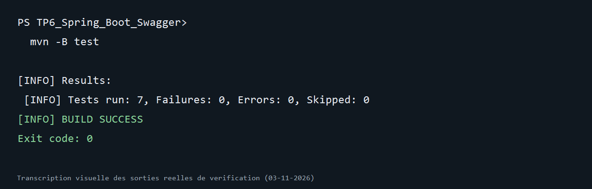

# TP6 — Spring Boot et Swagger

Projet Maven du [TP 6 du cours Architecture Microservices](https://mliaedu.toubkalit.com/student/courses/7/labs/157). Il expose une API REST pour gérer les étudiants, une statistique par année de naissance et une documentation OpenAPI interactive avec springdoc.

## Prérequis

- JDK 17 et Maven 3.6+
- MySQL 8 pour l'exécution normale

## Tester sans MySQL

```sh
mvn clean test
```

Les tests JUnit 5 et Mockito vérifient le contrôleur. Un test d'intégration utilise H2 en mémoire pour vérifier la sauvegarde, le comptage, la statistique et le document OpenAPI.

## Lancer avec MySQL

Créez la base `studentdb` (`CREATE DATABASE studentdb;`) puis renseignez vos identifiants MySQL dans `src/main/resources/application.properties` ou avec `-Dspring.datasource.*`.

```sh
mvn spring-boot:run
```

Swagger UI : <http://localhost:8080/swagger-ui.html>. Document OpenAPI : <http://localhost:8080/v3/api-docs>.

## Endpoints

| Méthode | URL | Résultat |
| --- | --- | --- |
| POST | `/students/save` | Enregistre un étudiant, 201 |
| GET | `/students/all` | Liste des étudiants, 200 |
| GET | `/students/count` | Nombre d'étudiants, 200 |
| GET | `/students/byYear` | Comptage par année, 200 |
| DELETE | `/students/delete/{id}` | 204 si trouvé, 404 sinon |

Exemple de corps POST :

```json
{"nom":"LACHGAR","prenom":"Mohamed","dateNaissance":"1985-09-01"}
```

Le repository Spring Data REST est utilisé en interne ; les routes HTTP explicites sont définies par `StudentController` pour conserver les chemins et statuts demandés dans le TP.

## Résultat vérifié

Commande exécutée le 3 novembre 2026 :

```powershell
mvn -B test
```

7 tests réussis, dont le test de l’API et du document OpenAPI avec H2 (0 échec).



L’image est une transcription visuelle de la sortie réelle de vérification ; la capture native de la fenêtre du terminal n’était pas disponible dans cet environnement.
